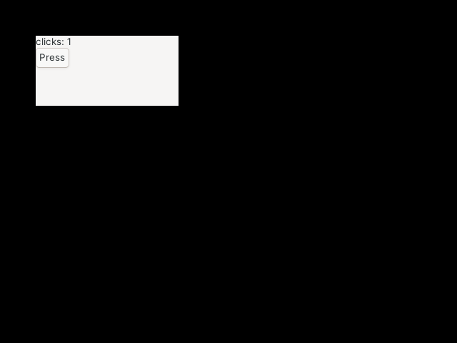

# env-iup

An environment for graphical user interfaces in [Atmos][lang], over
[IUP][iup] (Tecgraf, PUC-Rio), as a direct binding to its C interface.

Status: only the first check is done (IUP runs in the container, with
no screen). The environment itself (`iup.atm`) is not written yet. The
plan is in `.claude/plans/261113-env-iup.md`.

## IUP

IUP is not packaged in Ubuntu. `./get-iup.sh` fetches its official
binaries for Linux, at a fixed version (3.32, for x86-64 and GTK 3),
checks them by SHA-256, and extracts them into `iup/`, which git
ignores. Nothing of IUP is committed. They need the GTK 3 of the
system at run time (`libgtk-3-0`), and no package of development.

## The check

```
make i0
```

Builds `tst/i0.c` against `iup/` and runs it under a virtual display
(`xvfb-run`). The program opens a dialog with a button, presses it
with a mouse event (the global attribute `MOUSEBUTTON` of IUP), and
takes a screenshot with `import` (ImageMagick) into `out/i0.png`. It
exits with 0 if the callback of the button ran once.



[lang]: https://github.com/ia-atmos/lang
[iup]: https://www.tecgraf.puc-rio.br/iup/
