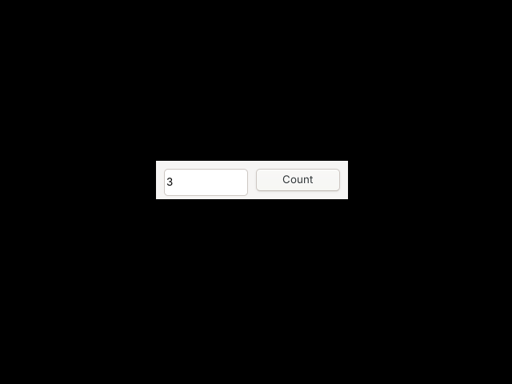
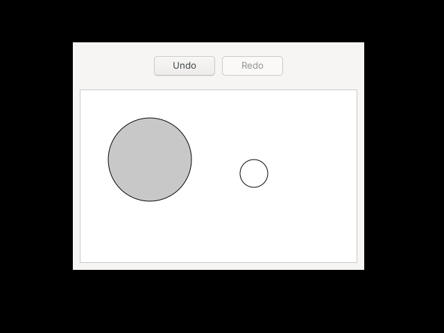
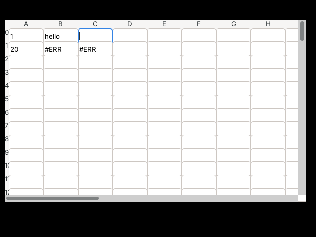

# env-iup

An environment for graphical user interfaces in [Atmos][lang], over
[IUP][iup] (Tecgraf, PUC-Rio), as a direct binding to its C interface.

A callback of a control becomes an event, so the logic of a dialog is
written as a sequence in time:

```
pin txt = iup.new(:text,   [value=0, readonly=true, size=60])
pin but = iup.new(:button, [title="Count", size=60])
pin dlg = iup.new(:dialog, [
    title  = "Button - Counter",
    margin = "10x10",
    iup.new(:hbox, [txt, but, ngap=10]),
])

iup.show(dlg)

watching :close [h=dlg] {
    loop on :action [h=but] {
        iup.set(txt, "VALUE", tonumber(iup.get(txt, "VALUE")) + 1)
    }
}
```



Status: experimental. The plan is in
`.claude/plans/261113-env-iup.md`.

## Examples

| | |
|-|-|
| `exs/hello.atm` | Only the time: a message every 500ms, for 5 seconds |
| `exs/button-counter.atm` | The program above |
| `exs/iup-net.atm` | The counter, with an echo client and server in the same program: the network is [`env-uv`][uv], polled by this environment at each tick |
| `exs/7guis/counter.atm` | [7GUIs][7guis], task 1 |
| `exs/7guis/temperature.atm` | Task 2: two fields that convert to each other |
| `exs/7guis/flight.atm` | Task 3: constraints between a choice, two dates, and a button |
| `exs/7guis/timer.atm` | Task 4: the time, a slider, and a reset, concurrently |
| `exs/7guis/crud.atm` | Task 5: a filtered list with create, update, and delete |
| `exs/7guis/circles.atm` | Task 6: a canvas, undo and redo, a menu, and a dialog that holds the main one |
| `exs/7guis/cells.atm` | Task 7: a spreadsheet, in which each formula is a task that awaits the cells it reads |




## Build

It needs the compiler ([`ia-atmos/lang`][lang]) built in `../lang`
(or `LANG_DIR=<dir>`), and the GTK 3 of the system (`libgtk-3-0`).
It is for Linux on x86-64.

```
make                                ;; fetches IUP, builds `atmos-iup`
./atmos-iup exs/button-counter.atm
```

`atmos-iup` is the compiler of Atmos dedicated to this environment: it
includes `iup.atm` before every program and passes the flags of IUP to
the C compiler. A program may also have `include "iup.atm"` and use
the plain compiler, with the flags in `ATMOS_CFLAGS` and
`ATMOS_LDFLAGS`.

IUP is not packaged in Ubuntu. `./get-iup.sh` fetches its official
binaries for Linux, at a fixed version (3.32, for x86-64 and GTK 3),
checks them by SHA-256, and extracts them into `iup/`, which git
ignores. Nothing of IUP is committed.

## Interface

The binding is thin and generic, as the C interface of IUP itself. See
the [guide](doc/guide.md) and the [API](doc/api.md). The
[study](doc/study.md) compares the seven tasks with versions in C with
callbacks (`study/`).

| Function | |
|----------|-|
| `iup.new(class, t)` | A control of the given class of IUP (`:button`, `:text`, `:hbox`, `:dialog`, ...). The named fields of `t` are its attributes, and the positional ones are its children |
| `iup.set(h, name, v)` | Sets an attribute |
| `iup.get(h, name)` | Reads an attribute, as a string or `nil` |
| `iup.show(h)`, `iup.hide(h)` | Shows or hides a dialog |
| `iup.popup(h, x, y)` | Shows a menu or a dialog, and holds the other dialogs until it closes |
| `iup.update(h)` | Asks a control to be drawn again |
| `iup.draw(h, op, ...)` | Draws on a canvas: `:begin`, `:end`, `:line`, `:rectangle`, `:arc`, `:text` |

| Event | Callback of IUP |
|-------|-----------------|
| `:action [h]` | `ACTION` (a button was pressed, ...) |
| `:value [h]` | `VALUECHANGED_CB` (a text was edited, ...) |
| `:close [h]` | `CLOSE_CB` (a dialog was closed) |
| `:button [h,but,press,x,y,status]` | `BUTTON_CB` (a button of the mouse on a canvas) |
| `:motion [h,x,y,status]` | `MOTION_CB` (the mouse moved on a canvas) |
| `:focus [h,focus]` | `GETFOCUS_CB` and `KILLFOCUS_CB` |
| `:popup [h]` | A popup was closed |

An event is emitted inside its callback, so the program reacts before
IUP goes on. What a callback returns to IUP is set before it happens,
in the attribute `ATM_<callback>` of the control:
`iup.set(dlg, "ATM_CLOSE_CB", "IGNORE")` refuses to close a dialog.

A handle is a native value: a control with no parent is destroyed when
its handle is released, and a dialog destroys its controls.

## Tests

```
make test
```

Each test is a program under a script of actions at given times (press
this button, set this value, close this dialog, save the screen), with
no person and no screen (`xvfb-run`), and with a virtual time. Its
output is compared with what is expected. They run plain and under the
address sanitizer. `make i0` is the first check of the plan: a program
in C that opens a dialog and presses its button.

[lang]: https://github.com/ia-atmos/lang
[iup]: https://www.tecgraf.puc-rio.br/iup/
[7guis]: https://eugenkiss.github.io/7guis/
[uv]: https://github.com/ia-atmos/env-uv
